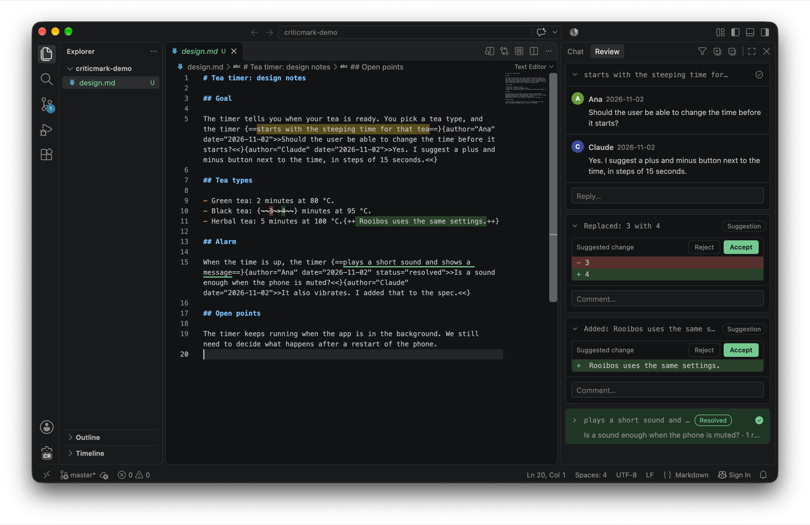
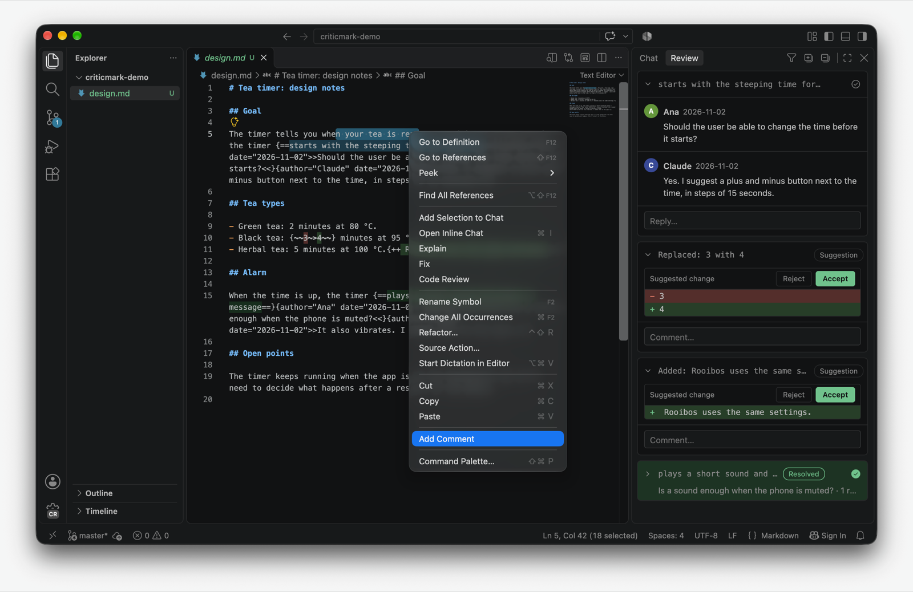

# CriticMark Review

Review CriticMarkup comments and suggestions in markdown files from a side panel in VS Code. You never edit the markup by hand: the extension writes it for you. Files stay compatible with the Track Changes plugin for Obsidian, and an AI agent can reply by editing the same file.



## What it does

- The **Review** panel in the right side bar lists every thread and suggestion of the active markdown file. If you do not see it, run **View: Open View…** and choose **Threads**.
- Select text, right-click, **Add Comment**. A new card opens in the panel with the cursor in its text box. Press **Comment** or `Cmd+Enter` (`Ctrl+Enter` on Windows and Linux) to write it to the file, or **Cancel** or `Escape` to drop it.
- Without the mouse: select text and press `Cmd+Alt+M` (`Ctrl+Shift+M` on Windows and Linux, where it replaces Show Problems while the editor has focus). Inside a comment or a suggestion, the same key opens its reply box. After you comment, reply or cancel, the cursor goes back to the file.

  
- Click a card's header to expand or collapse it and to bring its text to the top of the editor. The selected card has a coloured border, and a small mark appears beside its first line. Expanded, a card shows every comment and a reply box. The **…** menu on a comment has **Edit** and **Delete comment**; deleting the last comment deletes the thread. The **…** menu on a card's header has **Delete thread**.
- Suggestions show the change as a small diff with **Accept** and **Reject**.
- Click the check circle on a card to mark the thread as resolved. The card turns green and collapses, and its highlight in the editor gets a green underline. Click it again to reopen the thread.
- The panel's title bar has **Hide Resolved Threads**, **Expand All** and **Collapse All**.
- Right-click inside a comment for **Reply** and **Delete Thread**, or inside a suggestion for **Comment on Suggestion**, **Accept** and **Reject**.
- Suggestions (`{++…++}`, `{--…--}`, `{~~…~>…~~}`) are coloured in the editor.
- When the file changes on disk (for example an agent replied), the panel updates.

The extension saves the file after each change, so an agent reading the file on disk sees your comments at once.

## Reviewing other files

Code files cannot hold CriticMarkup without breaking their syntax, so the review of any other text file lives in a sidecar file next to it: `foo.c.review` for `foo.c`. You review the same way, from the same panel, and never open the sidecar. An agent reads it and replies in it. Markdown is always reviewed inline.

With no selection, a new comment quotes the current line, and on a blank line it stays on that line. For a comment about the whole file, comment on the first line and say so. Unlike in markdown, you can comment anywhere, including on code that already has a comment.

The differences from markdown:

- Your file only changes when you press **Accept**. Until then the new text of a replacement is drawn by the editor after the old text, and only its first line. The full text is on the card.
- A thread finds its place by searching for the code it quotes, and uses the lines around it to tell repeated code apart. If that code is rewritten or reformatted, the card shows **Orphaned** and has no highlight. **Accept** is refused for it.
- **Accept** is also refused when the same code appears several times and the lines around it do not identify the copy.
- `Cmd+Z` does not reach the sidecar, as with a pull request review. Comments can be edited or deleted and threads reopened, but a delete is final. After **Accept**, undo in the file restores the code and the suggestion stays gone.

Sidecar files are normal files in your repository. Do not add them to `.gitignore`, because that would hide open review comments, and remove them before you push. Agent replies appear at once for files in your workspace; for a file outside it, switch back to its editor.

## Install

Install CriticMark Review from the [Visual Studio Marketplace](https://marketplace.visualstudio.com/items?itemName=cuinixam.criticmark-review), or from the command line:

```bash
code --install-extension cuinixam.criticmark-review
```

Each [GitHub release](https://github.com/cuinixam/criticmark-review/releases) also has the `.vsix` file. To install it:

```bash
code --install-extension criticmark-review-<version>.vsix
```

To build it yourself instead (you need Node.js):

```bash
npm install
npx vsce package
code --install-extension criticmark-review-<version>.vsix
```

The steps are the same on macOS, Ubuntu and Windows.

## Releases

Every push to `main` runs the tests and then [semantic-release](https://semantic-release.gitbook.io/). It picks the next version from the commit messages (`fix:` and `feat:`), updates `CHANGELOG.md` and `package.json`, attaches the `.vsix` to a GitHub release, and publishes it to the Marketplace. Never change the version by hand.

## Settings

- `criticmarkReview.author`: the name written into new comments and replies. When empty, your system user name is used, or `User` if there is none.
- `criticmarkReview.sidecarExtensions`: the file extensions reviewed with a sidecar file, such as `[".c", ".py"]`. The default `["*"]` means all files, and `[]` means markdown only. Markdown is always reviewed inline.
- Colours: change `criticmarkReview.highlightBackground` (highlighted text) and `criticmarkReview.resolvedBackground` (resolved cards) under `workbench.colorCustomizations`.

## For AI agents

[docs/format.md](docs/format.md) describes the syntax, how threads are grouped, and how to reply, accept and reject.

## Credits

- [CriticMarkup](https://github.com/CriticMarkup/CriticMarkup-toolkit) by Gabe Weatherhead and Erik Hess is the base format.
- The [Track Changes plugin](https://obsidian.md/plugins?id=track-changes) for Obsidian by Phil Baum adds the `author` and `date` attributes, comment threads and the `{=+…+=}` element. This extension follows the plugin's behaviour so that a file reviewed in VS Code can be continued in Obsidian, and the other way round.
